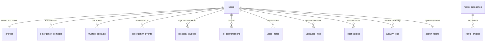

# Meyyurai Database Schema Specification

This document details the database architecture of Meyyurai safety, rights, emergency assistance, guidance, and support platform. The schema is implemented inside the PostgreSQL database (Supabase instance) under the `public` schema and interfaces with `auth.users` for access control.

---

## Architecture Entity-Relationship Map

---

## 1. Tables Directory

### 1.1 `public.users`

Stores user references synced automatically from Supabase Auth (`auth.users`).

- **Columns**:
  - `id` `uuid` (Primary Key) - References `auth.users(id)` ON DELETE CASCADE.
  - `email` `text` - Copy of user's registration email.
  - `phone_number` `text` - User's plain login phone number.
  - `created_at` `timestamptz` - Timestamp of user record creation.
  - `last_active_at` `timestamptz` - Timestamp of last api interaction.
- **Indexes**: Primary Key Index.
- **Triggers**: `on_auth_user_created` (fires after insert on `auth.users` to mirror record), `on_auth_user_updated` (fires on change).
- **RLS Policy**: Users can SELECT/UPDATE their own record (`auth.uid() = id`). Admins can SELECT all.

### 1.2 `public.profiles`

Stores metadata and details for each user.

- **Columns**:
  - `id` `uuid` (Primary Key) - References `public.users(id)` ON DELETE CASCADE.
  - `full_name` `text` - User's full name.
  - `avatar_url` `text` - URL link to user's profile photo in storage.
  - `preferred_language` `text` - Default language setting (English, Tamil, Hindi, Telugu, Kannada, Malayalam).
  - `country` `text` - Home country.
  - `state` `text` - Home state/province.
  - `city` `text` - Home city.
  - `onboarded` `boolean` - Tracks if user finished the signup onboarding profile setup.
  - `created_at` `timestamptz` - Account creation time.
  - `updated_at` `timestamptz` - Record last modification time.
- **RLS Policy**: Users can view and edit their own profile. Admins can manage all profiles.

### 1.3 `public.emergency_contacts`

Emergency contacts priority-ordered. Sensitive columns are encrypted using `pgcrypto`.

- **Columns**:
  - `id` `uuid` (Primary Key) - Default `gen_random_uuid()`.
  - `user_id` `uuid` - References `public.users(id)` ON DELETE CASCADE.
  - `name` `text` - Plain text name of contact.
  - `relationship` `text` - Contact relationship (Father, Mother, Friend, Lawyer, etc.).
  - `phone` `bytea` - **Encrypted** primary phone number.
  - `alternate_phone` `bytea` - **Encrypted** alternate phone number.
  - `email` `bytea` - **Encrypted** email address.
  - `priority_order` `integer` - Order priority (lower number = higher priority).
  - `is_primary` `boolean` - True if primary target.
  - `created_at` `timestamptz` - Row creation timestamp.
- **Indexes**: `idx_emergency_contacts_user` on `user_id`.
- **RLS Policy**: Users can perform all operations (CRUD) only on their own contacts (`auth.uid() = user_id`).
- **Security Function Access**: Managed via RPC wrappers `insert_emergency_contact`, `update_emergency_contact`, and `select_emergency_contacts` which supply the decrypt pepper.

### 1.4 `public.trusted_contacts`

List of contacts with accepted/pending status for location sharing.

- **Columns**:
  - `id` `uuid` (Primary Key) - Default `gen_random_uuid()`.
  - `user_id` `uuid` - References `public.users(id)` ON DELETE CASCADE.
  - `name` `text` - Name of contact.
  - `phone` `bytea` - **Encrypted** phone number.
  - `email` `bytea` - **Encrypted** email address.
  - `status` `text` - Tracking approval status (`pending`, `accepted`, `rejected`).
  - `priority_order` `integer` - Order priority.
  - `created_at` `timestamptz`.
- **Indexes**: `idx_trusted_contacts_user` on `user_id`.
- **Security Function Access**: Managed via RPC wrappers `insert_trusted_contact`, `update_trusted_contact`, and `select_trusted_contacts`.

### 1.5 `public.emergency_events`

Stores triggered SOS incidents.

- **Columns**:
  - `id` `uuid` (Primary Key) - Default `gen_random_uuid()`.
  - `user_id` `uuid` - References `public.users(id)` ON DELETE CASCADE.
  - `time` `timestamptz` - Time of trigger.
  - `latitude` `double precision` - Last known latitude on trigger.
  - `longitude` `double precision` - Last known longitude on trigger.
  - `accuracy` `double precision` - GPS coordinate radius accuracy in meters.
  - `device_info` `jsonb` - OS version, platform, battery state, network.
  - `emergency_type` `text` - Type category (SOS, Medical, Harassment, Custom).
  - `notes` `text` - Immediate incident text or notes.
  - `status` `text` - Active incident state (`active`, `resolved`, `cancelled`).
  - `created_at` `timestamptz`.
- **Indexes**: `idx_emergency_events_user` on `user_id`.
- **RLS Policy**: User can SELECT/INSERT/UPDATE their own events. Admins can view all.

### 1.6 `public.location_tracking`

Historical breadcrumbs log for active location sharing sessions.

- **Columns**:
  - `id` `uuid` (Primary Key) - Default `gen_random_uuid()`.
  - `session_id` `uuid` - Session token grouping breadcrumbs together.
  - `user_id` `uuid` - References `public.users(id)` ON DELETE CASCADE.
  - `latitude` `double precision` - Current coordinate latitude.
  - `longitude` `double precision` - Current coordinate longitude.
  - `accuracy` `double precision` - GPS coordinate accuracy.
  - `timestamp` `timestamptz` - Log record time.
  - `created_at` `timestamptz`.
- **Indexes**: `idx_location_tracking_session` on `session_id`, `idx_location_tracking_user` on `user_id`.
- **RLS Policy**: User can write and read their own location logs.

### 1.7 `public.ai_conversations`

Safety & legal assistant chats history log. Holds urgency classification levels.

- **Columns**:
  - `id` `uuid` (Primary Key) - Default `gen_random_uuid()`.
  - `user_id` `uuid` - References `public.users(id)` ON DELETE CASCADE.
  - `conversation_id` `uuid` - Interaction chat session identifier.
  - `user_question` `text` - Incoming question query text.
  - `ai_response` `text` - Structured guidance answer payload.
  - `language` `text` - Identified query/response language.
  - `urgency_detected` `boolean` - True if critical safety keywords are present.
  - `urgency_level` `text` - Urgency classification status (`LOW`, `MEDIUM`, `HIGH`, `CRITICAL`).
  - `created_at` `timestamptz` - Incident log time.
- **Indexes**: `idx_ai_conversations_user` on `user_id`.
- **RLS Policy**: User can view and update their own AI history.

### 1.8 `public.voice_notes`

Voice note recordings with public storage links and transcriptions.

- **Columns**:
  - `id` `uuid` (Primary Key).
  - `user_id` `uuid` - References `public.users(id)` ON DELETE CASCADE.
  - `audio_url` `text` - Public link to the storage bucket file.
  - `transcript` `text` - Plain text transcript output.
  - `language` `text` - Audio language identified.
  - `duration_seconds` `integer` - Sound duration length.
  - `created_at` `timestamptz`.
- **Indexes**: `idx_voice_notes_user` on `user_id`.
- **RLS Policy**: User can view and manage their own voice records.

### 1.9 `public.uploaded_files`

Registered attachments, evidence logs, pictures, and PDFs.

- **Columns**:
  - `id` `uuid` (Primary Key).
  - `user_id` `uuid` - References `public.users(id)` ON DELETE CASCADE.
  - `file_name` `text` - Original file name.
  - `file_path` `text` - Public URL link to storage object.
  - `file_type` `text` - MIME category (e.g. `image/png`, `application/pdf`).
  - `file_size` `integer` - Bytes.
  - `analysis_result` `jsonb` - Automatic scanning outcome metadata (anti-virus, keywords).
  - `created_at` `timestamptz`.
- **Indexes**: `idx_uploaded_files_user` on `user_id`.
- **RLS Policy**: User can manage their own uploaded files.

### 1.10 `public.rights_categories`

Education system support categories.

- **Columns**:
  - `id` `uuid` (Primary Key).
  - `slug` `text` (Unique) - Short string for URL routing (e.g. `women`, `cyber`).
  - `name` `text` - Display category label.
  - `icon` `text` - Lucide icon name string.
  - `description` `text` - Summary of rights included.
  - `priority_order` `integer` - Order ranking.
  - `created_at` `timestamptz`.
- **RLS Policy**: Public SELECT. Write operations are restricted to admin users.

### 1.11 `public.rights_articles`

Legislation documentation, guidelines, and procedures.

- **Columns**:
  - `id` `uuid` (Primary Key).
  - `category_id` `uuid` - References `public.rights_categories(id)` ON DELETE CASCADE.
  - `title` `text` - Title of right or act.
  - `description` `text` - Plain language summary.
  - `procedures` `jsonb` - Ordered list of steps to act.
  - `contact_resources` `jsonb` - Contact details for support orgs.
  - `emergency_numbers` `jsonb` - Associated hotline numbers.
  - `created_at` `timestamptz`.
  - `updated_at` `timestamptz`.
- **Indexes**: `idx_rights_articles_category` on `category_id`.
- **RLS Policy**: Public SELECT. Write operations restricted to admin.

### 1.12 `public.resources_directory`

Assistance database of support divisions.

- **Columns**:
  - `id` `uuid` (Primary Key).
  - `name` `text` - Title of organization.
  - `category` `text` - Service type (`Police`, `Hospital`, `NGO`, `Legal Aid`, `Shelter`, `Embassy`, `Mental Health`).
  - `address` `text` - Location street text.
  - `contact_number` `text` - Hotline phone details.
  - `website` `text` - Web link address.
  - `latitude` `double precision` - Map coordinates.
  - `longitude` `double precision` - Map coordinates.
  - `operating_hours` `text` - Hours of service.
  - `created_at` `timestamptz`.
- **Indexes**: `idx_resources_directory_geo` on `(latitude, longitude)`.
- **RLS Policy**: Public SELECT. Write operations restricted to admin.

### 1.13 `public.notifications`

Incidents alerts and follow-up warnings.

- **Columns**:
  - `id` `uuid` (Primary Key).
  - `user_id` `uuid` - References `public.users(id)` ON DELETE CASCADE.
  - `message` `text` - Text alert payload.
  - `type` `text` - Alert type (`emergency`, `security`, `update`, `follow_up`).
  - `status` `text` - Read state indicator (`unread`, `read`).
  - `delivery_time` `timestamptz` - Scheduled time of alert.
  - `created_at` `timestamptz`.
- **Indexes**: `idx_notifications_user_status` on `(user_id, status)`.
- **RLS Policy**: User can manage own alerts.

### 1.14 `public.activity_logs`

Production Audit Trail logging all critical actions.

- **Columns**:
  - `id` `uuid` (Primary Key).
  - `user_id` `uuid` - References `public.users(id)` ON DELETE CASCADE. Can be null for unauthenticated events.
  - `action` `text` - Identifier action text (e.g. `USER_LOGIN`, `SOS_ACTIVATED`).
  - `device_info` `jsonb` - Logging device browser user-agent and OS specs.
  - `ip_address` `text` - Logging IP address location.
  - `created_at` `timestamptz`.
- **Indexes**: `idx_activity_logs_user` on `user_id`.
- **RLS Policy**: User can SELECT/INSERT their own logs. Admins can view all.

### 1.15 `public.admin_users`

Administrators access table.

- **Columns**:
  - `id` `uuid` (Primary Key) - References `public.users(id)` ON DELETE CASCADE.
  - `role` `text` - Defaults to `admin`.
  - `created_at` `timestamptz`.
- **RLS Policy**: SELECT by authenticated users, edit by admins only.

### 1.16 `public.system_settings`

Global variables.

- **Columns**:
  - `key` `text` (Primary Key) - Configuration parameter name (e.g. `sos_config`).
  - `value` `jsonb` - Setting config key-values.
  - `updated_at` `timestamptz`.
- **RLS Policy**: Public SELECT. Write operations restricted to admin.

---

## 2. PostgreSQL Custom Security Functions

### 2.1 Encryption Helpers (`pgcrypto` integration)

- **`public.encrypt_field(plaintext text, key_str text) -> bytea`**: Encrypts text input with symmetric AES-256 (via `pgp_sym_encrypt`) using the specified decryption key.
- **`public.decrypt_field(ciphertext bytea, key_str text) -> text`**: Decrypts the binary bytea ciphertext into plain text (via `pgp_sym_decrypt`) using the specified decryption key.

### 2.2 Synchronized Triggers

- **`public.handle_new_user() -> trigger`**: Executed after insert on `auth.users`. It automatically maps credentials into `public.users` and creates a default state profile entry in `public.profiles`.
- **`public.handle_update_user() -> trigger`**: Executed after update of email or phone on `auth.users`. Keeps `public.users` synchronized.

### 2.3 Row Level Security Helpers

- **`public.is_admin(user_uuid uuid) -> boolean`**: Checks if the specified UUID exists in the `admin_users` table with the role `admin`. Used to authorize administrative requests.
